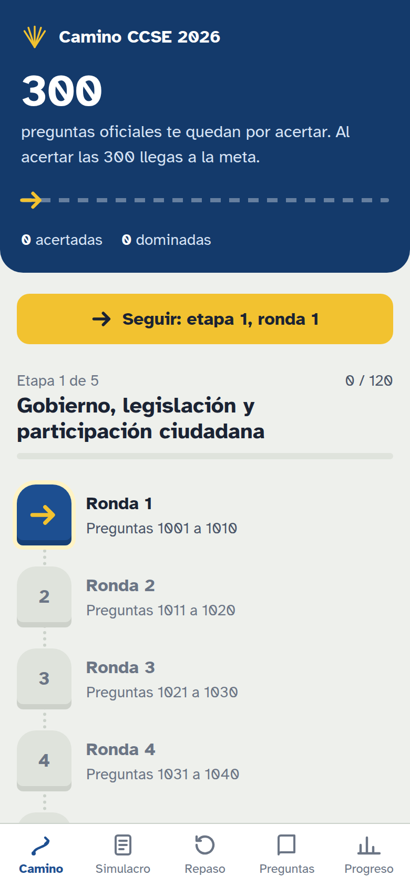

# Camino CCSE 2026

Web app gratuita para preparar la **prueba CCSE** (Conocimientos Constitucionales y Socioculturales de España), uno de los requisitos para obtener la **nacionalidad española**. Incluye las **300 preguntas oficiales** del *Manual de preparación de la prueba CCSE 2026* del Instituto Cervantes.

### 👉 [Abrir la app](https://jpinas1998.github.io/ccse-test/)

No hace falta registrarse ni instalar nada: se abre en el navegador del móvil o del ordenador. Si quieres, puedes **instalarla en el teléfono** como una app más, y funciona **sin conexión**.

<p align="center">
  
</p>

## Qué puedes hacer

- **Camino**: recorre las 300 preguntas en el orden del manual, por etapas (una por cada tarea del examen) y rondas cortas de 10 preguntas.
- **Simulacro**: exámenes como el real (25 preguntas, 45 minutos, apruebas con 15 aciertos), con el mismo reparto por tareas que la prueba oficial.
- **Repaso**: vuelve a las preguntas que has fallado y afianza las que ya sabes.
- **Preguntas**: consulta las 300 preguntas con su respuesta, una explicación, la cita del manual (con número de página) y fichas de resumen por tema.
- **Volver atrás**: durante una práctica o un simulacro puedes ir a las preguntas que ya has respondido para revisarlas (sin cambiar la respuesta) y luego seguir donde ibas.
- **Esquemas**: diagramas interactivos para entender las relaciones: los poderes del Estado (quién elige a quién y de quién depende cada institución), cómo se elige al presidente, cómo se hace una ley, la organización territorial, las fuerzas de seguridad, las lenguas, las elecciones, comunidades y provincias, ríos y climas, trámites y líneas del tiempo. Al responder una pregunta, la app te lleva al esquema y marca con ★ dónde encaja.
- **Progreso**: aciertos por tarea, historial de simulacros, las preguntas que más fallas y tu racha de días de estudio.
- Ajustes de tema claro u oscuro y tamaño de letra.

### Las 5 tareas de la prueba

| Tarea | Tema | Preguntas en el manual | Preguntas en el examen |
|---|---|---:|---:|
| 1 | Gobierno, legislación y participación ciudadana | 120 | 10 |
| 2 | Derechos y deberes fundamentales | 36 | 3 |
| 3 | Organización territorial y geografía | 24 | 2 |
| 4 | Cultura e historia de España | 36 | 3 |
| 5 | Sociedad española | 84 | 7 |

## Instalarla en el teléfono

**Android (Chrome)**: abre la app → menú **⋮** → **Instalar aplicación** (o *Añadir a pantalla de inicio*).

**iPhone / iPad (Safari)**: abre la app → botón **Compartir** → **Añadir a pantalla de inicio**.

**Ordenador (Chrome o Edge)**: pulsa el icono de instalar que aparece a la derecha de la barra de direcciones.

Una vez instalada se abre a pantalla completa, con su propio icono, y puedes estudiar sin conexión.

## Tu progreso

El progreso se guarda **solo en tu navegador**, en tu dispositivo: no se envía a ningún servidor. Para pasarlo a otro dispositivo o hacer una copia, ve a **Progreso → Exportar progreso** y luego **Importar progreso** en el otro dispositivo.

Si borras los datos del navegador, se borra también el progreso, así que conviene exportarlo de vez en cuando.

## Cómo está hecha

Es una web estática sin dependencias ni paso de compilación, publicada con GitHub Pages:

| Archivo | Para qué sirve |
|---|---|
| `index.html` | Toda la app: interfaz, lógica y las 300 preguntas (en un bloque JSON dentro del propio HTML). |
| `manifest.webmanifest` | Datos para instalarla como app (nombre, colores, iconos). |
| `sw.js` | Service worker que la guarda en caché para usarla sin conexión. |
| `icons/` | Iconos de la app. |

Para probarla en local basta con servir la carpeta, por ejemplo:

```sh
python3 -m http.server 8000
# y abre http://localhost:8000
```

Al cambiar cualquier archivo, sube el valor de `VERSION` en `sw.js` para que los dispositivos que ya la tienen instalada descarguen la versión nueva (la verán en la siguiente apertura).

## Aviso

Esta app **no es oficial** ni está relacionada con el Instituto Cervantes. Las preguntas, respuestas y citas proceden del *Manual de preparación de la prueba CCSE 2026* publicado por el Instituto Cervantes; las explicaciones son material de estudio propio basado en ese manual. Para inscribirte en la prueba y consultar la información oficial, visita [examenes.cervantes.es](https://examenes.cervantes.es/es/ccse).

Si encuentras un error en alguna pregunta o explicación, [abre un issue](https://github.com/jpinas1998/ccse-test/issues).
